<p align="center">
  <a href="https://harmowizu.my.id"></a>
</p>

<p align="center">
  <a href="https://harmowizu.my.id"></a>
  
</p>

### `> whoami`

Hi, I'm Prayoga. I run **[HarmoWizu](https://harmowizu.my.id)**, a small studio in Jakarta that builds websites, back-office systems and chatbots for local businesses. Kos owners, music studios, shops. The kind of places still running on WhatsApp chats and a notebook.

Most of what I ship runs on Cloudflare Workers with a React front end. I like it boring on the server and a little extra in the browser.

```js
const prayoga = {
  role:     "Founder @ HarmoWizu",
  based:    "Jakarta, ID",
  builds:   ["business websites", "management systems", "automation", "AI chatbots"],
  stack:    ["React", "Cloudflare Workers", "Hono", "D1", "Three.js"],
  rule:     "if the owner can't use it without me, it isn't done",
};
```

### `> ls ./shipped`

<a href="https://harmowizu.my.id"></a>





<a href="https://github.com/prayogahxr/duitgue"></a>

### `> cat stack.txt`

<p>
  
</p>

### `> git log --stats`

<p align="center">
  
  
</p>

### `> contact`

Got a business that needs a site or a system? Say hi at **[harmowizu.my.id](https://harmowizu.my.id)**. First consultation is free.

<sub>Punya usaha dan butuh website atau sistem? Konsultasi pertama gratis, langsung aja ke harmowizu.my.id.</sub>

<p align="center"></p>
